SSHZYU 提供统一的 AI API 接入入口。本教程按第一次使用的顺序，说明注册、充值、创建密钥、配置客户端、首次调用和用量核对。

> 视频模型、异步任务接口和价卡已经拆分到 [视频 API 文档](/docs/vedio/)。

> **先保护好密钥：** API 密钥相当于账户密码。请只在可信设备中使用，不要发送给陌生人，也不要放进截图、聊天记录或公开代码仓库。首次使用建议先小额充值，再用一条短消息完成测试。

## 开始前先了解

- **API 密钥相当于账户密码。** 请妥善保管，并在怀疑泄露时立即禁用旧密钥。
- **分组决定可用模型和计费规则。** 倍率、模型、速度和线路以创建密钥时的页面说明为准。
- **先小额测试。** 确认请求成功、用量记录和扣费都正常后，再进行正式调用。
- 本文的 API 地址统一使用 `https://sshzyu.com`，不要把其他网站的地址和密钥照抄过来。

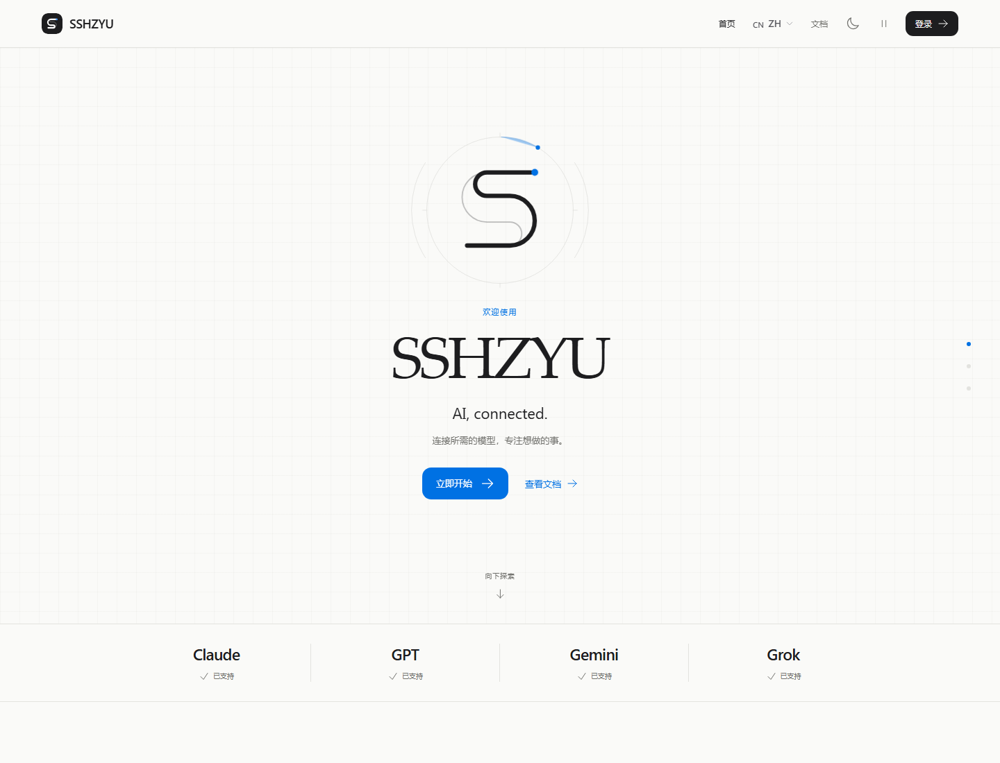

*图 1：打开 SSHZYU 后，点击“立即开始”进入注册或登录流程。*

## 一、注册并登录 SSHZYU

打开 [SSHZYU 注册页](https://sshzyu.com/register)，按页面提示完成注册和邮箱验证。

1. 填写可以正常接收邮件的邮箱。
2. 设置一个没有在其他网站重复使用的密码。
3. 按页面提示完成验证码或邮箱验证。
4. 注册完成后打开 [登录页](https://sshzyu.com/login)。

> 如果注册页面提示暂未开放注册，以站点首页公告为准，不要反复提交注册请求。

## 二、充值并确认余额

登录后，从侧边栏进入充值或购买入口，按页面提示完成充值。首次使用建议只充值够测试的金额。

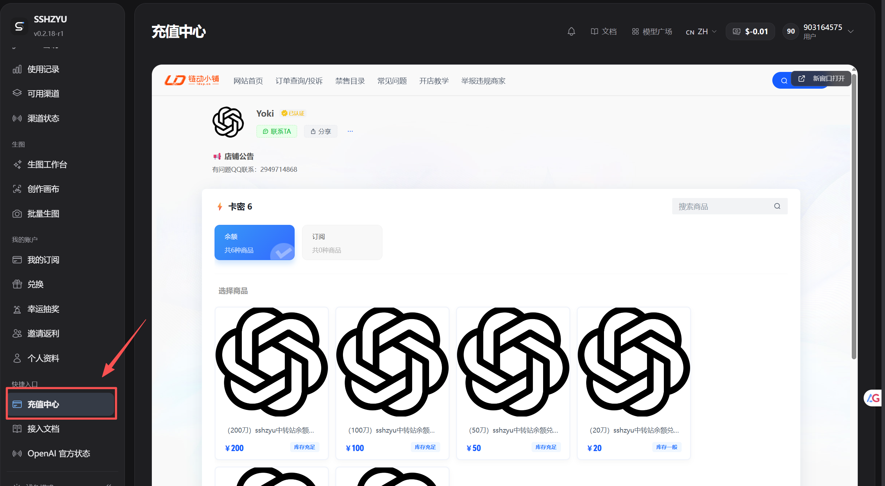

*图 2：点击侧边栏底部的“充值中心”，选择需要购买的余额商品。*

1. 充值完成后刷新页面，确认账户余额已经更新。
2. 先发送一条简短测试消息，确认模型和扣费正常。
3. 如果支付成功但余额没有更新，请保留订单号和支付截图，到 QQ 群 `565037127` 联系管理员。

> 倍率、模型价格、赠送额度和退款规则可能调整，最终以 SSHZYU 当前页面和使用记录为准。

## 三、创建 API 密钥

打开 [API 密钥页面](https://sshzyu.com/keys)，点击右上角“创建密钥”。

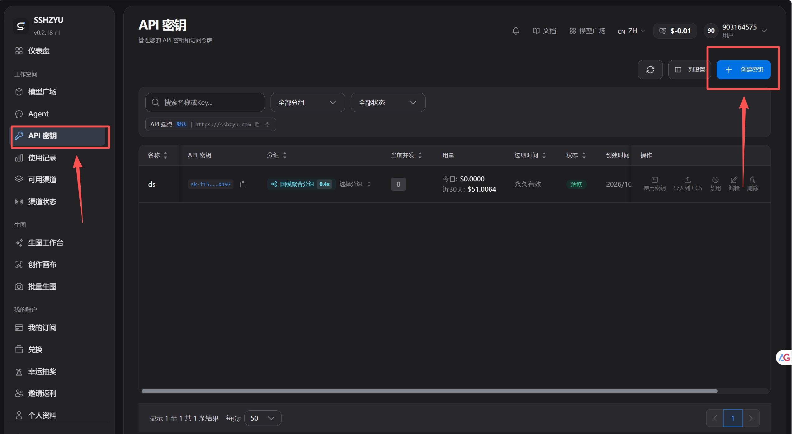

*图 3：进入左侧“API 密钥”页面，点击右上角“创建密钥”。*

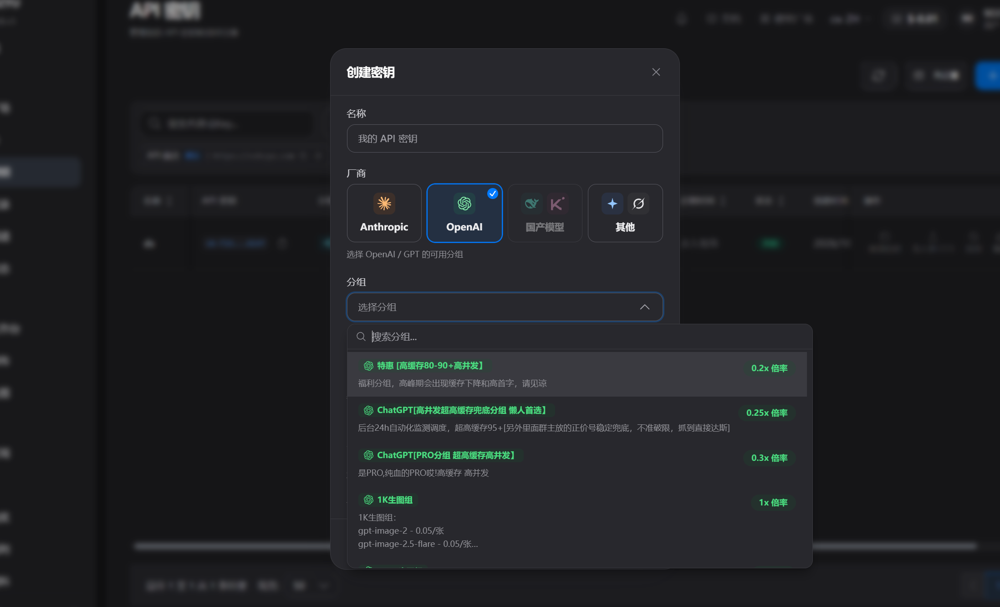

*图 4：填写密钥名称，选择厂商和分组；未显示的额度与限制项按页面实际选项设置。*

创建密钥时，建议按以下方式设置：

1. **名称：**填写容易识别的名称，例如 `我的 Codex` 或 `测试密钥`。
2. **分组：**根据页面显示的稳定性、速度、适用模型和倍率选择。
3. **自定义密钥：**新手建议关闭，让系统自动生成。
4. **IP 限制：**第一次使用建议关闭，确认固定出口 IP 后再设置。
5. **额度限制：**测试时建议设置小额度；页面中的 `0` 通常表示不限制，具体以页面提示为准。
6. **速率限制和有效期：**不熟悉时保持默认。

> 选择分组不要只看倍率。低倍率可能对应不同的速度或稳定性，建议先用短请求测试，再根据使用记录选择适合自己的分组。

## 四、下载和配置 CC Switch

[CC Switch](https://ccswitch.io/zh/download) 是用于管理 Claude、Codex 等 AI 编程工具配置的桌面工具。推荐先从官方地址下载安装，再选择一键导入或手动添加供应商。

### 从官网下载并安装

1. 打开 [CC Switch 官方下载页](https://ccswitch.io/zh/download)。
2. 根据自己的系统选择 Windows、macOS 或 Linux 版本。
3. 下载完成后运行安装包，按系统提示完成安装。
4. 启动 CC Switch；浏览器询问是否允许打开应用协议时，选择允许。

需要查看源码或发行版本时，可以访问 [CC Switch 官方 GitHub](https://github.com/farion1231/cc-switch)。

> 只从 `ccswitch.io` 或官方 GitHub 下载 CC Switch，不要使用来历不明的二次打包安装包。

### 一键导入 SSHZYU

安装并启动 CC Switch 后，回到 SSHZYU 的 API 密钥列表：

1. 点击密钥右侧的“导入到 CC Switch”。
2. 浏览器询问是否打开 CC Switch 时，选择允许打开。
3. 在 CC Switch 导入窗口中核对地址为 `https://sshzyu.com`。
4. 选择实际使用的应用，并确认导入。
5. 在 CC Switch 中启用 SSHZYU 配置，确认对应卡片显示为使用中。

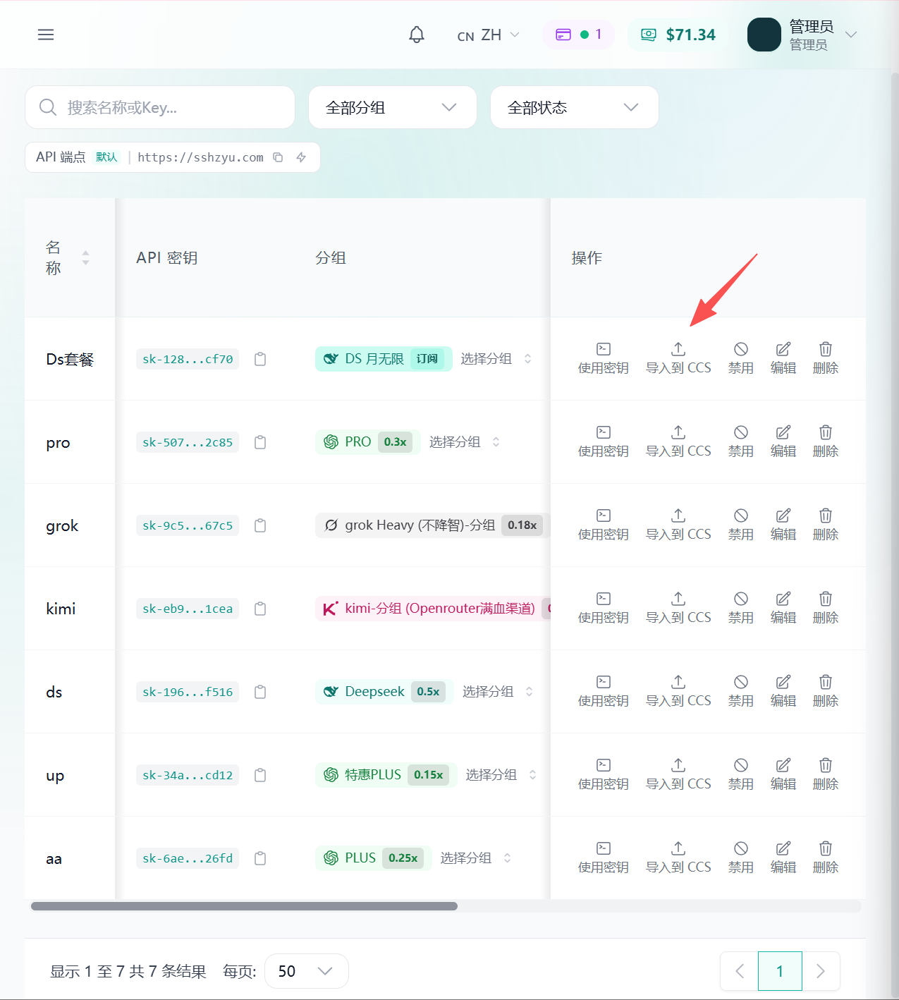

*图 5：点击密钥行右侧的“导入到 CC Switch”。*

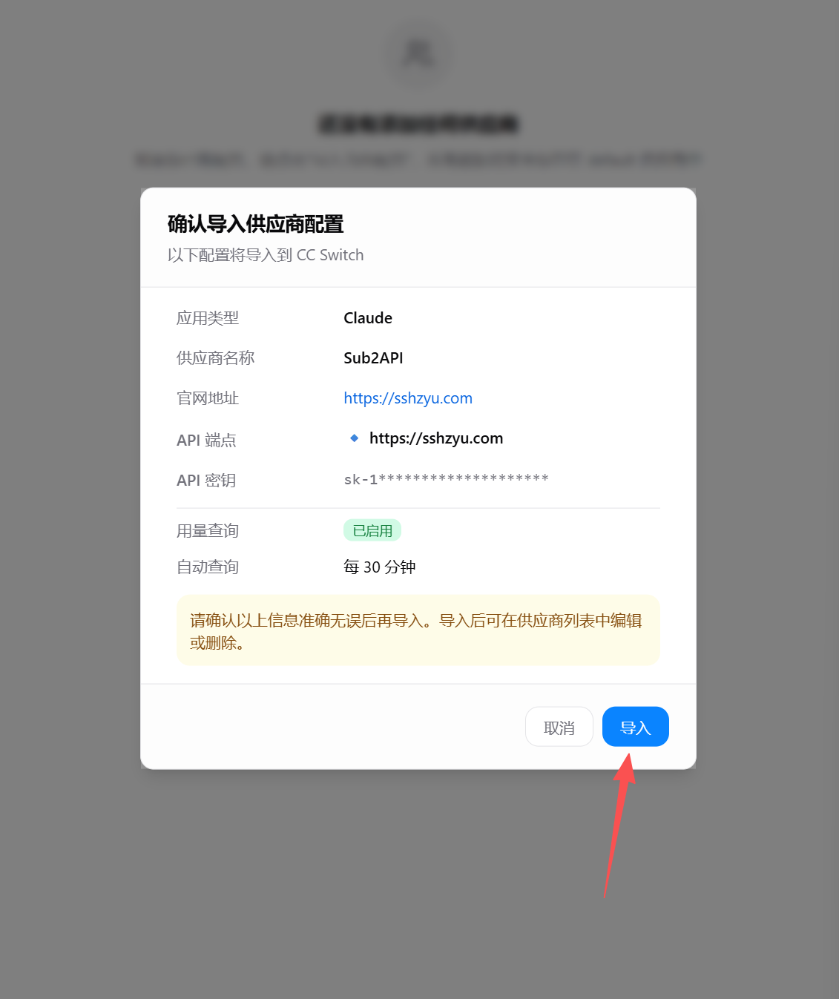

*图 6：确认供应商名称、API 地址和打码后的 API 密钥，再点击“导入”。*

### 手动添加供应商

一键导入失败，或者需要自己控制模型名称时，可以在 CC Switch 中手动添加供应商。

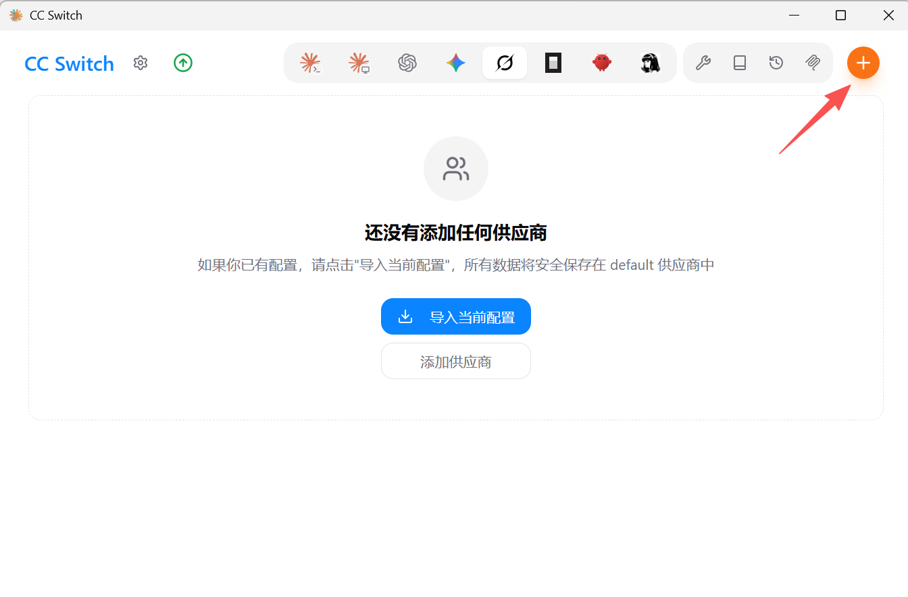

*图 7：在 CC Switch 中点击加号或“添加供应商”。*

| 字段 | 填写内容 |
| --- | --- |
| 供应商名称 | SSHZYU |
| 官网链接 | `https://sshzyu.com` |
| API Key | 复制 SSHZYU API 密钥页面中的下游密钥，不要填写上游 Key、登录密码或其他网站密钥 |
| API 请求地址 | `https://sshzyu.com`，除非页面明确给出完整 URL，否则不要自行追加 `/chat/completions` |
| 默认模型 | 填写当前分组实际支持的完整模型 ID |

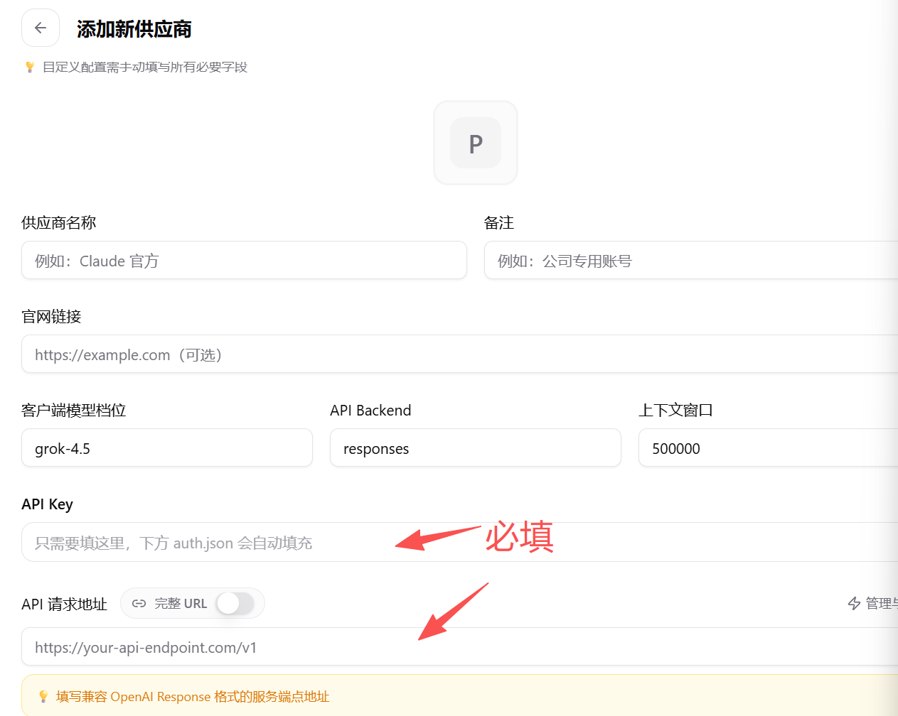

*图 8：API Key 必须填写；模型名称只作为示例，请使用当前分组支持的模型 ID。*

添加供应商后仍不能调用时，先检查三项：密钥是否有效、模型 ID 是否在该分组中、请求地址是否为 `https://sshzyu.com`。

### 一键导入没有反应

- 确认 CC Switch 已经安装并正在运行。
- 换用 Chrome 或 Edge 再点击一次。
- 浏览器出现“是否打开 CC Switch”时选择允许。
- 仍然失败时，使用上面的手动配置方法。

## 五、手动配置位置

如果没有使用 CC Switch，可以在 API 密钥列表中点击“使用密钥”，复制页面为当前密钥生成的配置。

Windows 常见配置位置：

```text
%USERPROFILE%\.codex\config.toml
%USERPROFILE%\.codex\auth.json
```

macOS 或 Linux 常见配置位置：

```text
~/.codex/config.toml
~/.codex/auth.json
```

不要把完整 API 密钥发给客服或放进截图。如果怀疑密钥泄露，请立即在 API 密钥页面禁用旧密钥并创建新密钥。

## 六、把 Claude 或其他模型配置到 Codex

Claude 能否在 Codex 中使用，取决于 SSHZYU 是否已经把它转换成 OpenAI Responses API 兼容接口。不能把 Anthropic 原生 API 地址直接填进 Codex。

推荐直接在 API 密钥列表点击“导入到 CC Switch”或“使用密钥”，使用页面为当前分组生成的配置。

### 先确认模型 ID

1. 进入 [API 密钥页面](https://sshzyu.com/keys)，确认密钥所属分组。
2. 查看该分组支持的模型列表。
3. 复制页面显示的完整模型 ID，不要自行简写，也不要照抄其他网站的名称。

教程中的 `填写后台显示的模型 ID` 只是占位符，必须替换为当前分组实际存在的模型。

### 通过 CC Switch 添加其他模型

1. 打开 CC Switch，点击添加新供应商。
2. 供应商名称填写 `SSHZYU`，官网链接填写 `https://sshzyu.com`。
3. API Key 粘贴 SSHZYU 当前分组的下游密钥。
4. API 请求地址填写 `https://sshzyu.com`，除非站点明确提供了完整接口地址。
5. 把默认模型替换为当前分组实际支持的完整模型 ID。
6. 保存供应商，再把当前模型配置导入 Codex。
7. 启用 SSHZYU 配置，重启 Codex 后发送一条短消息测试。

### 手动编辑 config.toml

打开 `%USERPROFILE%\.codex\config.toml`，替换模型 ID 后写入以下配置：

```toml
model = "填写控制台显示的模型 ID"
model_provider = "sshzyu"

[model_providers.sshzyu]
name = "SSHZYU"
base_url = "https://sshzyu.com/v1"
env_key = "SSHZYU_API_KEY"
wire_api = "responses"
```

然后在当前 PowerShell 窗口临时设置密钥：

```powershell
$env:SSHZYU_API_KEY = "你的 SSHZYU API 密钥"
```

环境变量只在当前 PowerShell 窗口有效。不要把完整密钥写入公开脚本、截图或 GitHub。如果使用 CC Switch，优先让它管理密钥。

### 配置其他模型

其他模型的写法相同，只需要修改两个位置：

| 位置 | 修改内容 |
| --- | --- |
| `model` | 填写 SSHZYU 当前分组实际支持的模型 ID |
| `base_url` | 使用 SSHZYU 提供的 Responses 兼容入口；如果页面生成的配置不是 `/v1`，以页面结果为准 |

如果模型或上游只提供 Chat Completions 或 Anthropic 原生协议，而没有 Responses 兼容入口，Codex 可能无法使用。此时不要只改模型名，应先确认当前分组是否支持 Codex。

## 七、启动并完成首次测试

确认 CC Switch 中的 SSHZYU 配置已经启用，再启动 Codex，发送一条短消息：

```text
你好，请只回复：SSHZYU 配置成功
```

测试成功后，打开 [使用记录](https://sshzyu.com/usage)，确认刚才的请求已经出现。能看到请求记录和用户扣费，才算配置完成。

如果 Codex 仍然要求登录官方账户，通常是本地配置尚未生效。完全退出 Codex，确认 CC Switch 中 SSHZYU 显示使用中，再重新启动。

## 八、其他客户端调用

OpenAI 兼容客户端通常需要填写：

| 参数 | 值 |
| --- | --- |
| Base URL | `https://sshzyu.com/v1` |
| Chat Completions | `https://sshzyu.com/v1/chat/completions` |
| API Key | SSHZYU API 密钥页面创建的下游密钥 |
| Model | 当前分组支持的完整模型 ID |

```bash
curl https://sshzyu.com/v1/chat/completions \
  -H "Authorization: Bearer 你的 API 密钥" \
  -H "Content-Type: application/json" \
  -d '{
    "model": "填写分组支持的模型名",
    "messages": [{"role": "user", "content": "你好，请只回复：调用成功"}]
  }'
```

如果客户端要求填写 `/v1`，按客户端字段说明填写。不要把 `/chat/completions` 填进 Base URL。

### 接入 NewMax

[NewMax](https://newmax.cc/download) 支持添加自定义提供商。SSHZYU 可以作为 OpenAI 兼容接口接入。

1. 打开 NewMax，点击侧栏底部头像，再进入“设置”。
2. 点击左侧“模型”，再点击“添加提供商”。
3. 供应商类型选择 OpenAI（兼容）。
4. 填入 Base URL、API Key 和模型，点击“测试连接”。
5. 保存后回到对话，在模型选择器中选择 SSHZYU 模型。

| 字段 | 值 |
| --- | --- |
| 供应商类型 | OpenAI（兼容） |
| Base URL | `https://sshzyu.com/v1` |
| API Key | SSHZYU API 密钥页面创建的下游密钥 |
| 模型 | 当前分组实际支持的模型 ID |

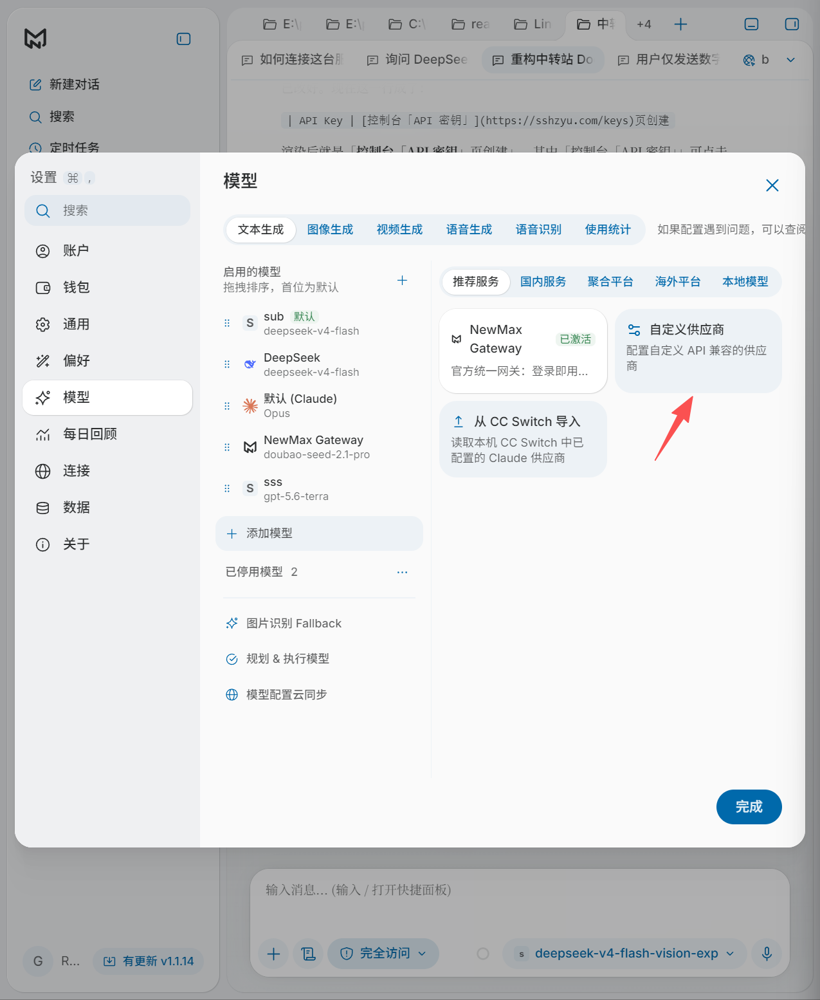

*图 9：在 NewMax 中添加自定义 OpenAI 兼容提供商。*

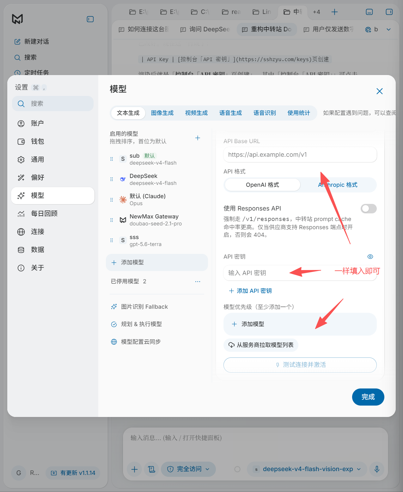

*图 10：API 地址、API Key 和模型都按当前 SSHZYU 控制台显示填写。*

如果已经在 CC Switch 中添加 SSHZYU，也可以在 NewMax 的“添加模型”页面选择“从 CC Switch 导入”，让 NewMax 自动带入 Base URL、API Key 和模型列表。

### 安装 SSHZYU 生图 Skill

把下面这段提示词完整发给 Agent。Agent 会安装预构建 Skill、执行安装检查并报告结果；你不需要手工下载、编写脚本或提供 API Key。

```text
请安装 SSHZYU 生图 Skill。

下载：
https://sshzyu.com/docs/install/sshzyu-image.zip

安装后：
1. 解压后应得到 sshzyu-image/ 目录。
2. 将整个 sshzyu-image/ 目录安装到当前 Agent 的全局 Skill 目录。Codex 默认使用 ~/.codex/skills/sshzyu-image。
3. 使用 Python 3 运行安装目录下的 scripts/sshzyu_image.py --doctor。
4. 确认 SKILL.md、scripts/sshzyu_image.py 和 references/ 均已安装。
5. 报告安装目录和 --doctor 结果。

约束：
- 不要生成图片。
- 不要读取、输出或保存真实 API Key。
- 不要修改 Skill 文件。
- 不要使用 npx，也不要访问 GitHub。
- 安装失败时停止并报告完整错误，不要自行改写脚本。
```

> 安装 Skill 不需要 API Key。需要生图时，再按 Skill 的提示在本地录入密钥。

## 九、查看 Token 和扣费

进入 [使用记录](https://sshzyu.com/usage)，查看每一次请求的模型、端点、分组、Token、费用、延迟和时间。

| 字段 | 含义 |
| --- | --- |
| 输入 Token | 发送给模型的提示词、历史上下文和工具结果 |
| 输出 Token | 模型生成的回答 |
| 缓存 Token | 复用上下文时产生的缓存用量，具体以页面记录为准 |
| 倍率 | 该请求使用的分组倍率 |
| 用户扣费 | 该笔请求最终从账户余额扣除的金额 |

页面金额可能经过小数位显示处理。余额和该笔使用记录中的最终扣费，是判断实际消耗的依据。

## 十、常见报错

| HTTP 状态 | 常见含义 | 排查方向 |
| --- | --- | --- |
| `400` | 请求格式错误 | 检查请求体、必填字段和接口地址 |
| `401` | 认证失败 | 检查 API Key、`Bearer` 前缀和密钥状态 |
| `402` | 余额不足 | 到控制台确认余额并完成充值 |
| `403` | 权限不足 | 检查分组、模型权限和接口类型 |
| `404` | 资源不存在 | 检查 URL、模型 ID 和查询任务使用的密钥 |
| `429` | 频率或并发受限 | 停止重复请求，降低频率后再试 |
| `500` / `502` / `503` | 服务或上游暂时异常 | 稍后重试，并记录错误信息 |

### 401、Unauthorized 或 `invalid_api_key`

- 确认使用的是 SSHZYU 的下游 API 密钥，而不是上游 Key。
- 在 API 密钥页面确认密钥状态为活跃，必要时重新创建并配置。
- 如果密钥曾经发给别人，立即禁用旧密钥。

### 余额不足或无法继续调用

- 检查账号余额。
- 检查 API 密钥是否设置了额度上限，以及额度是否用完。
- 充值后刷新页面，再发送一条短请求测试。

### 429、请求过多或并发已满

- 等待正在运行的请求结束后再试。
- 不要同时开启过多任务。
- 检查当前分组的并发、速率和模型说明。

### 模型不可用或 model not supported

- 回到 API 密钥页面，确认当前分组支持的模型。
- 不要照抄其他网站或其他分组的模型名。
- 切换分组后，重新生成或检查客户端配置。

### 超时或长时间没有首字

- 先发送一句简短测试语句，排除上下文过大的问题。
- 检查本地网络和可能冲突的代理规则。
- 记录发生时间、报错文字和所选分组，到 QQ 群 `565037127` 反馈。

## 十一、密钥安全建议

- 一个设备或一个用途使用一个独立密钥，方便排查和停用。
- 测试密钥设置小额度，确认稳定后再调整。
- 不要在聊天、截图、视频、直播或公开代码仓库中展示完整密钥。
- 怀疑泄露时立即禁用旧密钥并创建新密钥。
- 定期检查使用记录，发现异常消费及时处理。

## 十二、加入 SSHZYU 用户群

遇到配置、模型或调用问题，可以加入 SSHZYU 用户群查看通知并交流。QQ 群号：`565037127`。

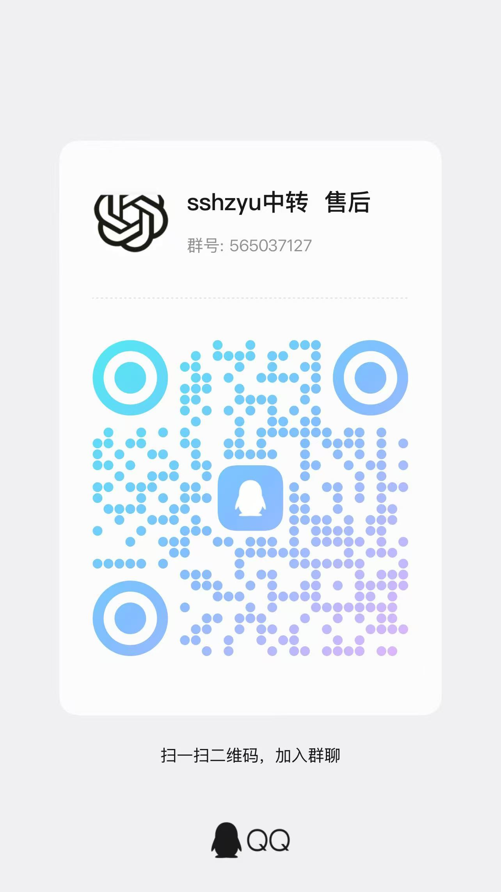

*图 11：SSHZYU 用户群二维码，群号 565037127。*

咨询时请提供报错文字、发生时间和所选分组；不要发送完整 API 密钥、密码或个人隐私信息。

## 十三、完成检查

- 已注册并登录 SSHZYU。
- 余额足够完成一次小额测试。
- 已创建 API 密钥并选择分组。
- CC Switch 或客户端已经使用 `https://sshzyu.com`。
- 测试消息可以正常返回。
- 使用记录中可以看到请求和最终扣费。
- 完整 API 密钥没有发送给任何人。
